<p align="center">
  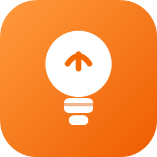
</p>

<h1 align="center">IoT Smart Control for Windows</h1>

<p align="center">
  An unofficial Windows desktop app (C# / .NET 10 / WPF) for LEDVANCE SMART+ WiFi lights and plugs —
  controlled locally over your Wi-Fi (Tuya LAN or Matter), through the Tuya cloud, or through Samsung SmartThings.
</p>

It brings the day-to-day features of the **LEDVANCE SMART+ WiFi Android app** (v1.3.2) to Windows as a native,
local-control-first client, with Dark/Light theming and a tray-resident scheduler. The Smart+ app is a
white-label **Tuya Smart** client, so this app speaks the same protocols Tuya devices already use rather than
reusing the vendor's embedded credentials.

<p align="center">
  <a href="https://github.com/sreddev/IoT-Smart-Control/releases/latest"><b>Download for Windows</b></a> ·
  <a href="docs/ARCHITECTURE.md">Architecture</a> ·
  <a href="docs/INTEGRATION-NOTES.md">Integration notes</a> ·
  <a href="CHANGELOG.md">Changelog</a>
</p>

## Install

Download the latest release from **[Releases](https://github.com/sreddev/IoT-Smart-Control/releases/latest)**.
Both packages are self-contained: no .NET or Node.js install is needed (Node.js for Matter is bundled).

| Package | Use it when |
|---|---|
| **`IoTSmartControl-<version>-Setup-x64.exe`** (recommended) | You want a normal Windows install: Start menu entry, start with Windows, in-place upgrades with an optional **clean install**, and an uninstaller that asks whether to **keep or delete your settings**. Installs for your user without admin rights (or for all users). |
| `IoTSmartControl_<version>.0_x64.msix` + `IoTSmartControl-Test.cer` | You prefer an MSIX package. It is signed with a self-signed test certificate: trust it once in an elevated PowerShell (`Import-Certificate -FilePath .\IoTSmartControl-Test.cer -CertStoreLocation Cert:\LocalMachine\TrustedPeople`), then `Add-AppxPackage .\IoTSmartControl_<version>.0_x64.msix`. |

Upgrading with the `.exe` shows **Upgrade and keep my settings** (default) or **Clean install**, which first
deletes the previous version and all its settings. Unattended: `/VERYSILENT /CLEANINSTALL` for setup,
`/VERYSILENT /DELETEDATA` for the uninstaller. Verify downloads with `SHA256SUMS-<version>.txt`.

> The installer isn't code-signed yet, so Windows SmartScreen may show *"Windows protected your PC"*: choose
> **More info → Run anyway**.

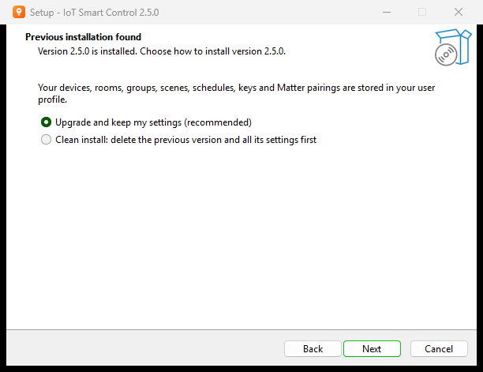

## Screenshots

| Light panel (Devices) | Plug energy monitor |
|---|---|
| 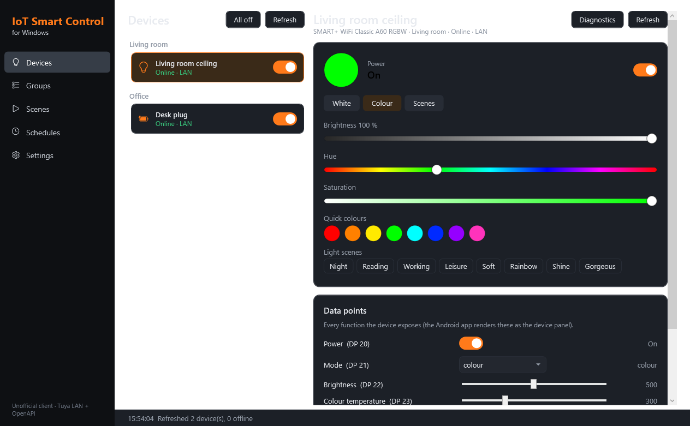 | 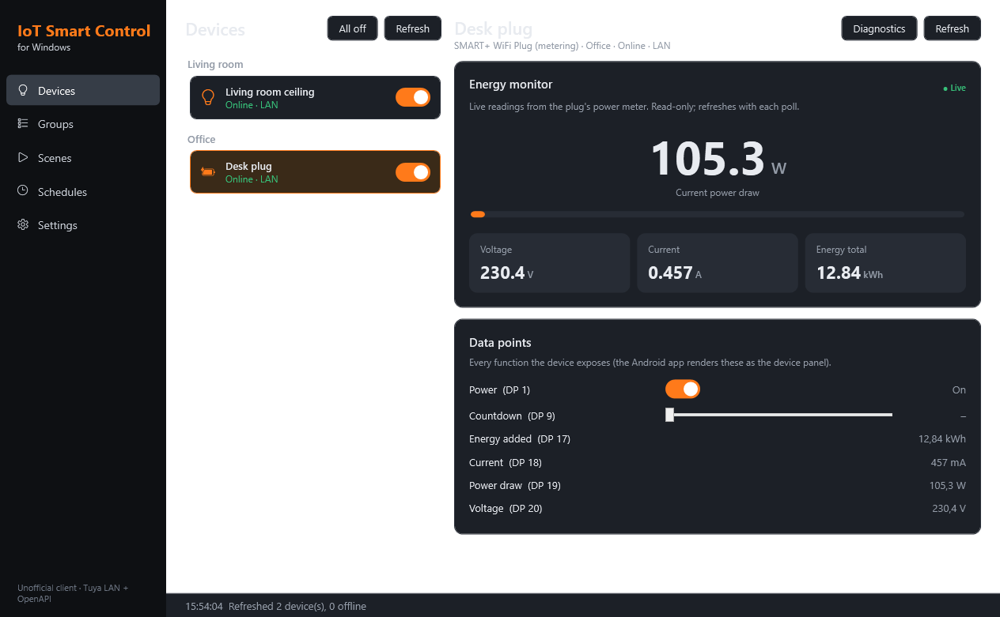 |

| Settings (keys and addresses blurred) | Schedules |
|---|---|
| 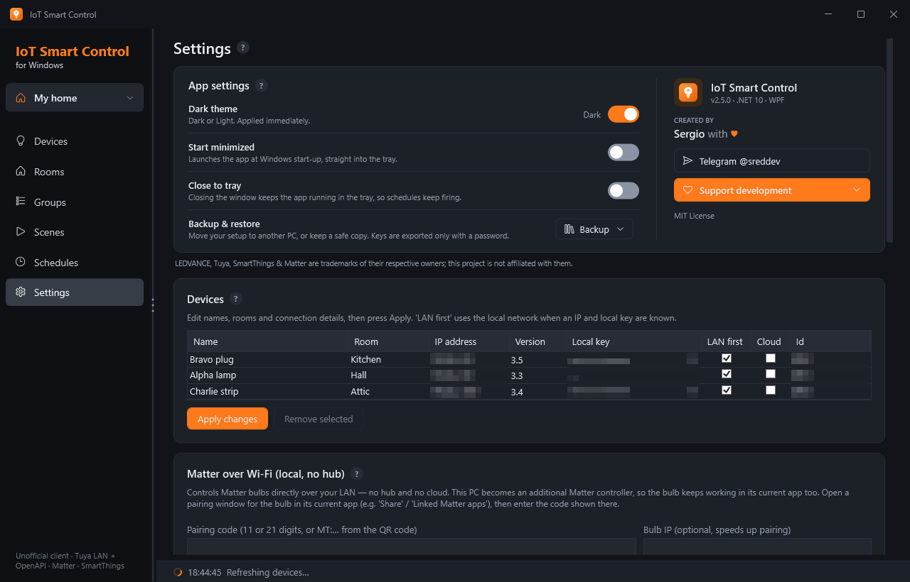 | 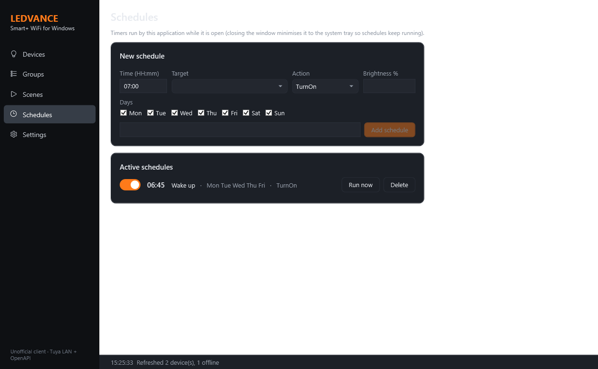 |

Dark (default) and Light themes — switch with **Settings → App settings → Dark theme**:

| Devices (light) | Settings (light) |
|---|---|
| 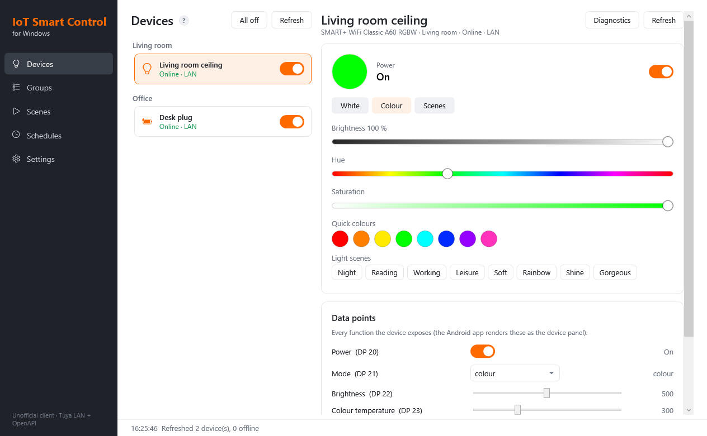 | 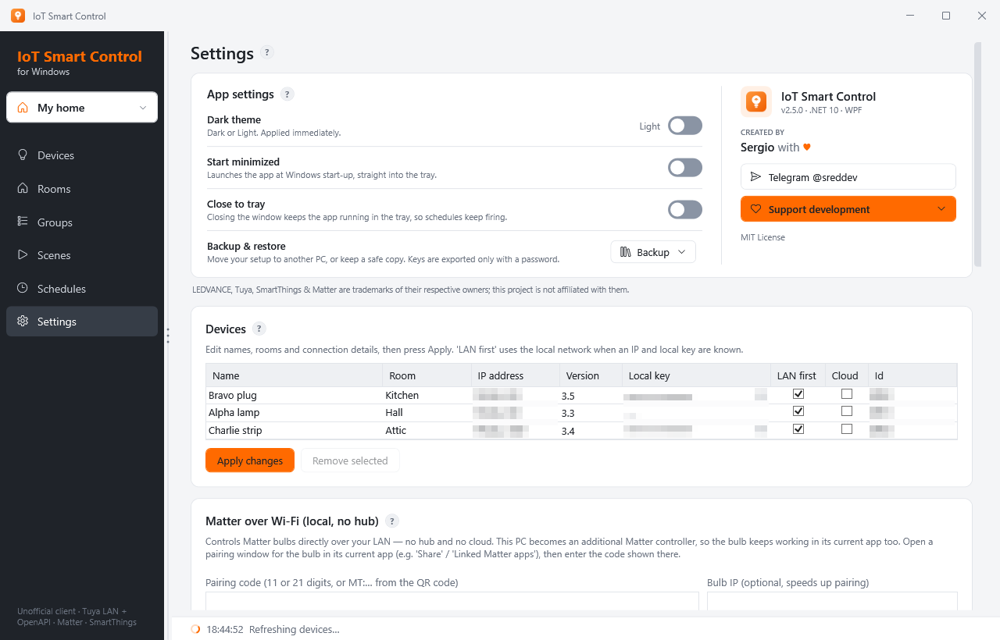 |

## Backup & restore

**Settings → App settings → Backup** saves your whole setup to one `.iscbackup` file and brings it back on this
or another PC.

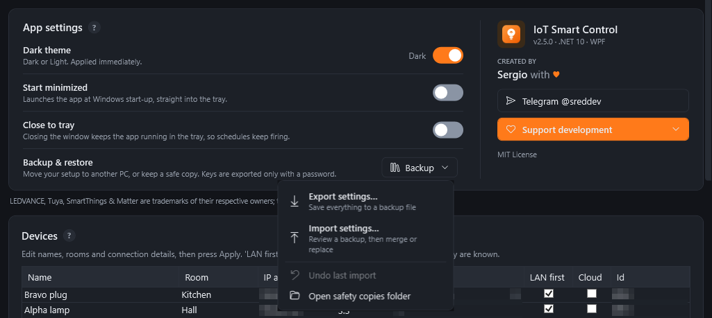

| Export | Import |
|---|---|
| 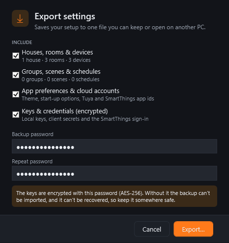 | 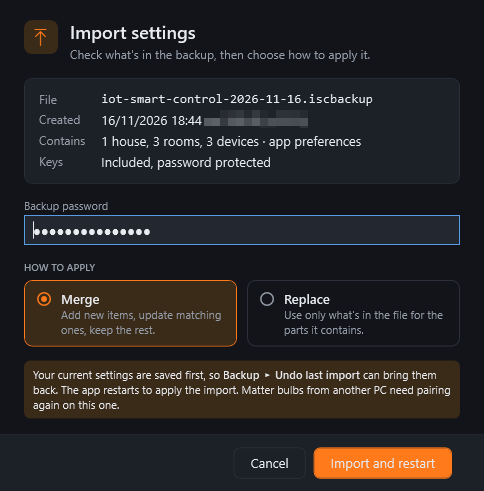 |

- **Export settings…** — choose what to include: houses, rooms & devices; groups, scenes & schedules; app
  preferences & cloud accounts; keys & credentials. **Keys are only exported with a password** and are then
  encrypted with it (AES-256-GCM, key from PBKDF2-HMAC-SHA256, 600 000 iterations). The password can't be
  recovered.
- **Import settings…** — shows what the file contains (date, PC, counts) before anything changes, asks for the
  password, then **Merge** (add new, update matching, keep the rest) or **Replace** (only what's in the file,
  for the parts it carries). The app restarts to apply it.
- **Undo last import** — your current settings are saved automatically before every import; this puts them
  back. **Open safety copies folder** shows those copies (the newest 10 are kept).
- A file that was edited after export is rejected. Matter pairings belong to the PC that made them, so Matter
  bulbs are paired again on a new PC.

## In-app help

Every page title and every Settings section has a **?** indicator that opens a themed, step-by-step guide —
so the connectivity and setup instructions below are also available inside the app.

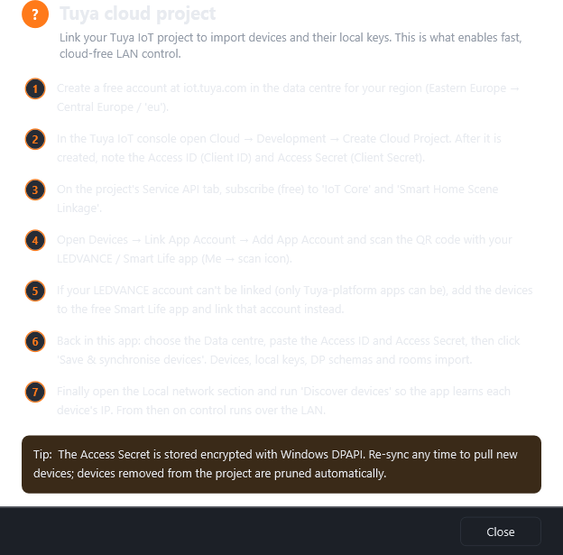

## Features

### Implemented

| Smart+ Android app | This app |
|---|---|
| Device list grouped by room, on/off | **Devices** page grouped by room, quick toggles, live LAN / Cloud / SmartThings / Matter / Offline status; **Edit** renames a device or moves it to another room |
| Light panel | Power, white mode (brightness, colour temperature), colour mode (hue / saturation / brightness, quick colours) and the 8 built-in Tuya light scenes (Night, Reading, …) |
| Socket / plug panel | **Energy monitor**: live power draw (W), voltage (V), current (A) and cumulative energy (kWh), read from the plug's metering DPs — plus the plug on/off switch |
| Generic device panels | Every data point (DP) rendered from the device schema: switches, sliders, drop-downs, text; read-only values (power, voltage, …) shown too |
| Homes & rooms | **Houses → rooms → devices**: several houses with a picker at the top left that also adds, renames and deletes them (the last one always stays); rooms per house; tick devices into a room and switch / dim a whole room. SmartThings locations and Tuya homes become houses automatically; names you set here are kept across syncs. Cloud devices stay in their cloud's house; a Matter bulb moves only after you confirm you moved it in SMART+ |
| Groups | **Groups**: user-defined groups controlled together (power, brightness, colour, scenes) |
| Scenes / tap-to-run | **Scenes**: local scenes captured from current device states, plus cloud scenes (run) and cloud automations (enable/disable) |
| Timers / schedules | **Schedules**: daily / weekday timers for a device, group or scene, optional brightness; the app stays in the tray while schedules are enabled |
| Account / home | **Settings**: app settings, backup & restore, Tuya cloud sync, Matter pairing, SmartThings connect/sync, LAN discovery, tinytuya import, manual devices, per-device connection details (sortable tables, masked keys) |
| — | **Backup & restore**: export to a password-protected file, import with a preview and Merge / Replace, undo the last import |
| — | **Matter over Wi-Fi**: pair Matter bulbs (e.g. SMART+ Matter RGBW) straight to the PC and control them over the LAN — no hub, no cloud (power, brightness, colour, white temperature; works with groups, scenes and schedules) |

### Not implemented

These need Tuya's private app credentials or hardware Windows doesn't have, so pair/manage them with the phone
app once — this app then controls the devices:

- **Pairing brand-new devices** to Wi-Fi (EZ/AP/BLE onboarding)
- **BLE mesh**, **cameras**, **firmware (OTA) updates**
- **Device sharing** between accounts
- **Alexa / Google Home linking**
- Live power **measurement for bulbs** — smart bulbs have no power-meter chip, so they report no
  voltage/current/power. (A *rated-wattage × brightness* estimate is feasible and may be added later.)

## How it connects

The app reaches your devices by four routes and prefers the local ones automatically:

1. **Tuya LAN protocol** (3.1 / 3.3 / 3.4 / 3.5) — direct, cloud-free control over your Wi-Fi. Needs each
   device's **local key** (from the Tuya cloud sync or a tinytuya import) and its IP.
2. **Tuya IoT Platform OpenAPI** — device lists, local keys, DP schemas, rooms, cloud scenes and automations;
   also the fallback channel when a device isn't reachable on the LAN.
3. **Samsung SmartThings** (OAuth 2.0 REST) — for bulbs **brand-locked to LEDVANCE** that can't be re-paired to
   Tuya/Smart Life but are visible in SmartThings. On/off, brightness, colour and colour-temperature.
4. **Matter over Wi-Fi** — direct, cloud-free and hub-free control of Matter bulbs on your LAN. The PC joins the
   bulb as an extra Matter controller (multi-admin), so it keeps working in its current app. Runs a small
   [matter.js](https://github.com/project-chip/matter.js) controller as a Node.js sidecar (Node.js is bundled
   with the installers; a source build uses Node.js LTS from the PATH).
   Matter-over-**Thread** bulbs are not reachable this way (a PC has no Thread radio) — they need a border router.

> **Brand-locking.** LEDVANCE bulbs ship locked to the LEDVANCE app and won't pair to generic Tuya/Smart Life
> (pairing fails at cloud registration), and Tuya→SmartThings linking is one-way. If your bulbs are in this
> state, use the **SmartThings** route below.

## Connectivity guide

You only need **one** route per device. Use **Tuya** if your account links to the Tuya IoT platform (gives you
true local control); use **SmartThings** if your bulbs are brand-locked.

### A) Tuya cloud + local control — step by step

1. Go to <https://iot.tuya.com> and create a free account in the data centre that matches your region
   (Eastern Europe → **Central Europe / `eu`**).
2. **Cloud → Development → Create Cloud Project.** Pick your data centre. After creation, note the
   **Access ID / Client ID** and **Access Secret / Client Secret**.
3. On the project's **Service API** tab, subscribe (free) to **IoT Core** and **Smart Home Scene Linkage**.
4. Open the **Devices** tab → **Link App Account** → **Add App Account**, and scan the QR code with your
   LEDVANCE/Smart Life app ("Me → ⊙ scan"). Your devices now appear under the project.
   *If your LEDVANCE account can't be linked (only Tuya-platform apps can), add the bulbs to the free
   **Smart Life** app and link that account instead.*
5. In this app: **Settings → Tuya cloud project**, choose the data centre, paste **Access ID** and
   **Access Secret**, and press **Save & synchronise devices**. Devices, local keys, DP schemas and rooms import.
6. **Settings → Local network → Discover devices (10 s)** so the app learns each device's IP and protocol
   version. Allow it through the Windows firewall when prompted. From then on control runs over the LAN, with
   the cloud as fallback.

### B) SmartThings — step by step (for brand-locked bulbs)

1. Make sure the bulbs already work in the **SmartThings** app on your phone.
2. Install the SmartThings CLI and create an **OAuth-In** app:
   ```
   smartthings apps:create
   ```
   Choose **OAuth-In App**; set scopes `r:devices:* x:devices:* w:devices:* r:locations:*`.
   For the redirect URI, SmartThings rejects `http://localhost`, so use an HTTPS page that just echoes the
   returned code — e.g. `https://httpbin.org/get`. Note the generated **Client ID** and **Client Secret**.
3. In this app: **Settings → SmartThings**, enter the **Client ID**, **Client Secret** and the same
   **Redirect URI** you registered.
4. Click **Open sign-in page**, approve access in the browser, and copy the **`code`** value from the resulting
   URL/page.
5. Paste it into the app and click **Use code**, then **Sync SmartThings devices**. Status shows **Connected**
   and control runs through the SmartThings cloud (needs internet).

### C) Matter bulbs over Wi-Fi — step by step (no hub)

1. The installers include Node.js. *Running from source?* Install **Node.js LTS** from <https://nodejs.org>
   and restart the app.
2. Keep the bulb working on your Wi-Fi in its current app, with the PC on the same network.
3. In that app, open the bulb's Matter settings and share / link it with another Matter app. On Android this is
   also under **Settings → Google → Devices & sharing → Matter devices → (bulb) → Linked apps → Link apps**.
   A pairing code appears and the bulb opens a pairing window for a few minutes.
4. In this app: **Settings → Matter over Wi-Fi** → optionally **Find devices in pairing mode** (fills in the IP),
   type the code and click **Pair Matter device**. The bulb shows up as **Online · Matter (LAN)**.

Allow Node.js through the Windows firewall when asked (mDNS on UDP 5353, Matter on UDP 5540).

### D) Already have tinytuya?

If you ran `python -m tinytuya wizard` before and have a `devices.json`, skip the cloud setup:
**Settings → Local network → Import tinytuya devices.json…**, then **Discover devices**.

## Settings reference

Every section on the **Settings** page:

- **App settings** — dark or light theme, start minimized at Windows start-up, close to tray, and the
  **Backup** menu (export, import, undo last import, safety copies folder). About and support links on the right.
- **Tuya cloud project** — connect to your Tuya IoT project: pick the data centre, enter Access ID / Secret, and
  **Save & synchronise devices** to import devices, local keys, DP schemas, rooms, cloud scenes and automations.
  Optional; needed only for the Tuya route.
- **Matter over Wi-Fi** — enter a Matter **pairing code** (11/21 digits or `MT:…`) and optionally the bulb's IP,
  then **Pair Matter device**. **Find devices in pairing mode** lists bulbs with an open pairing window;
  **Refresh Matter devices** re-reads the devices paired with this PC. Removing a Matter device in **Devices**
  also removes this PC from the bulb's Matter controllers.
- **SmartThings** — connect a SmartThings OAuth app (Client ID, Secret, Redirect URI). **Open sign-in page** →
  approve → paste the **code** → **Use code**, then **Sync SmartThings devices**. The connection status is shown
  here. Use this for bulbs that only live in SmartThings.
- **Local network** — **Discover devices (10 s)** listens to the UDP broadcasts devices send (ports
  6666/6667/7000) and fills in IP addresses and protocol versions of known devices; allow the app through the
  Windows firewall when asked. **Import tinytuya devices.json…** loads devices from a tinytuya export. Results
  appear in a table (device id, IP, version, product key).
- **Devices** — edit names, rooms and connection details for every known device: IP address, protocol version,
  local key, and **LAN first** (use the local network when an IP and key are known). **Cloud** shows whether the
  device came from a cloud sync. **Apply changes** saves; **Remove selected** deletes a device. Local keys are
  masked: click a key cell to show or hide it. Click any column header to sort (again to reverse); IP addresses
  sort numerically.
- **Add a device manually** — add a device by hand when you already know its **id**, **local key** (16 chars),
  **IP**, protocol **version** and **type** (`dj` = light, `cz` = plug, `kg` = switch). Useful for devices not
  discovered automatically.

## Build & run

```
dotnet build LedvanceControl.slnx -c Release
dotnet run --project src/LedvanceControl.App
```

Run `dotnet test` for the protocol tests (a simulated 3.3/3.4/3.5 device lives in
`tests/LedvanceControl.Tests/FakeTuyaDevice.cs`).

What we learned about the LEDVANCE SMART+ app, Matter bulbs, SmartThings and Tuya (and the Windows networking
pitfalls of Matter) is collected in [`docs/INTEGRATION-NOTES.md`](docs/INTEGRATION-NOTES.md).

The Matter bridge (`src/LedvanceControl.MatterBridge`) is a Node.js script bundled with esbuild into a single
`matter-bridge/bridge.mjs` next to the exe. The App build does this automatically (`npm ci` + `npm run build`)
when Node.js/npm are installed; without them the app builds and runs, just without Matter. At run time the app
uses `LEDVANCE_NODE`, a bundled `matter-bridge/node/node.exe`, or `node` on the PATH.

### Release packages

One command runs the tests and builds everything a release ships (needs the Windows SDK, Inno Setup 6 and
Node.js):

```powershell
pwsh packaging/build-release.ps1   # → packaging/out: Setup .exe, signed .msix + .cer, SHA256SUMS
```

`build-msix.ps1` on its own builds the Store package (`pwsh packaging/build-msix.ps1` = unsigned, for Partner
Center). The Store numbers its packages independently: Store 1.0.0.0 is app version 2.5.0. See [`packaging/README.md`](packaging/README.md) for the installer options, the MSIX manifest and the
Store requirements.

Configuration is stored in `%APPDATA%\IoTSmartControl\config.json` (Linux: `~/.config/IoTSmartControl/`; a
config from an earlier build under `%APPDATA%\LedvanceControl` is migrated automatically on first run). Set
`LEDVANCE_CONFIG` to use a different file.

**Secrets are never written in plain text.** The Tuya cloud secret, SmartThings client secret and refresh token,
device local keys and the Matter storage key are encrypted with the platform's secret store:

| Platform | Secret store |
|---|---|
| Windows | DPAPI, current user (`dpapi:` values) |
| Linux (e.g. Fedora) | AES-256-GCM (`aesgcm1:` values) with a random master key kept in the desktop keyring (Secret Service via `secret-tool`), or else in a `systemd-creds --user` credential (systemd 256+, TPM2-bound where available) |
| neither available | secrets are **not saved** (the app says so in Settings and Matter stays off) |

The Matter controller's storage (fabric root key, operational key, certificates, paired bulbs) is encrypted too:
the bridge receives its key over stdin and encrypts every stored value with AES-256-GCM. The data folder is
owner-only (Windows: you and SYSTEM; Linux: `0700`/`0600`). Device local keys are masked in Settings (click a
key to reveal it). How all of this fits together, with diagrams, is in
[`docs/ARCHITECTURE.md`](docs/ARCHITECTURE.md).

## Project layout

```
src/LedvanceControl.Core     protocol + logic (no UI, cross-platform)
  Local/    TuyaCodec (framing, crypto), TuyaLocalClient (TCP session), TuyaDiscovery (UDP),
            MatterBridgeClient (Node sidecar over stdio), MatterMapping (Matter clusters↔DP)
  Cloud/    TuyaCloudClient (OpenAPI signing), SmartThingsClient (OAuth + REST), SmartThingsMapping (capability↔DP)
  Lights/   HsvColor (Tuya colour encodings), LightProfile (DP mapping, scenes)
  Model/    config store, default DP schemas, sort keys, tinytuya importer
  Security/ secret protection (DPAPI, AES-GCM + keyring / systemd-creds), file permissions
  Backup/   SettingsBackup: .iscbackup export / import, merge rules, safety copies
  Services/ DeviceManager, DeviceRuntime (routing, stale-report hold), LatestOnlySender, Scheduler
src/LedvanceControl.App      WPF UI (MVVM), Dark/Light themes, energy monitor, tray scheduler, backup dialogs
src/LedvanceControl.MatterBridge  Node.js Matter controller (matter.js), JSON lines over stdio, encrypted storage
tests/LedvanceControl.Tests  xUnit tests: fake Tuya device, fake SmartThings API, backup, security, latency logic
packaging/                   build-release.ps1, Inno Setup installer (installer/), MSIX manifest + assets
docs/                        ARCHITECTURE.md, INTEGRATION-NOTES.md, screenshots
```

## Credits

Made with ♥ by Sergio — GitHub [@sreddev](https://github.com/sreddev) · Telegram [@sreddev](https://t.me/sreddev).

LEDVANCE, Tuya and SmartThings are trademarks of their respective owners. This project is not affiliated with them.

## License

[MIT](LICENSE). The installers bundle Node.js, distributed under its own license
(`matter-bridge\node\LICENSE` in the install folder).
