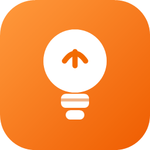
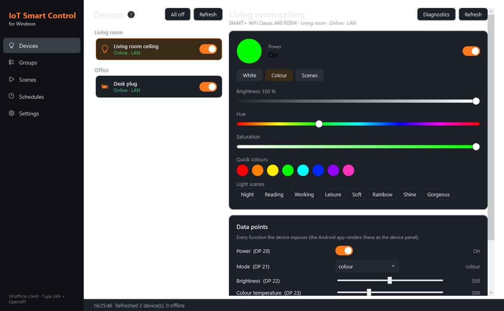
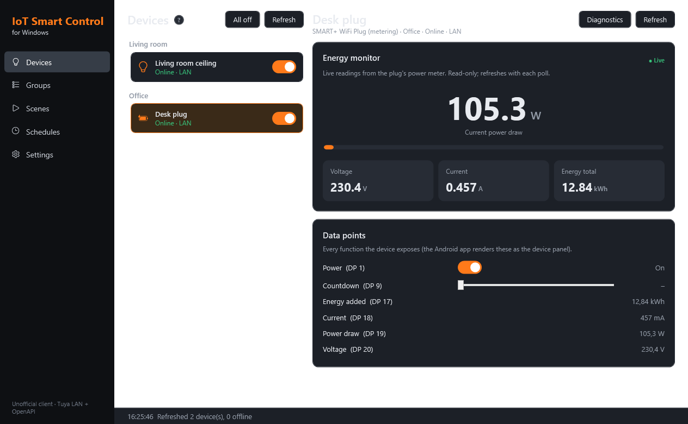
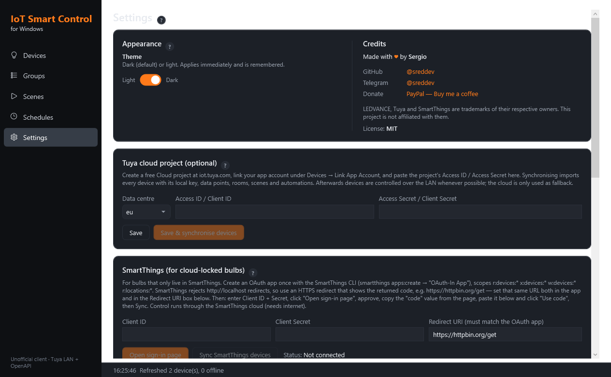
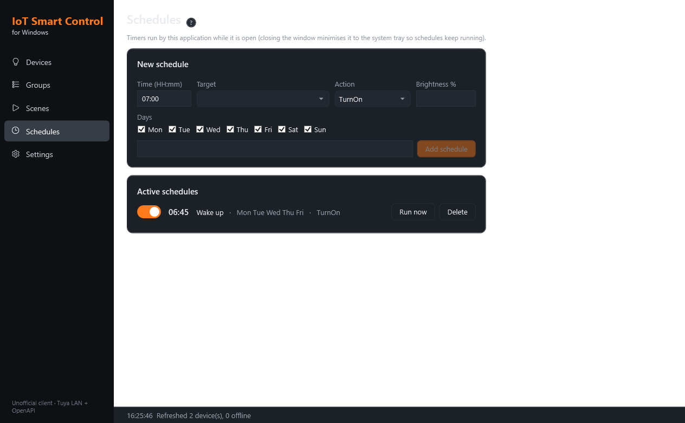
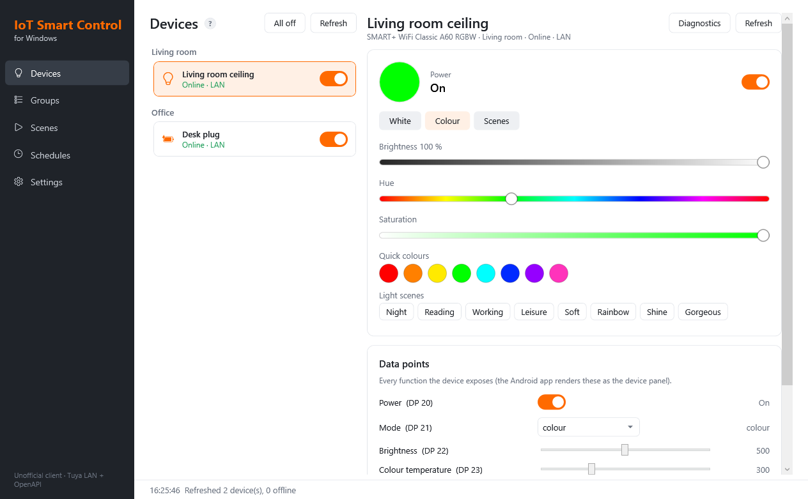
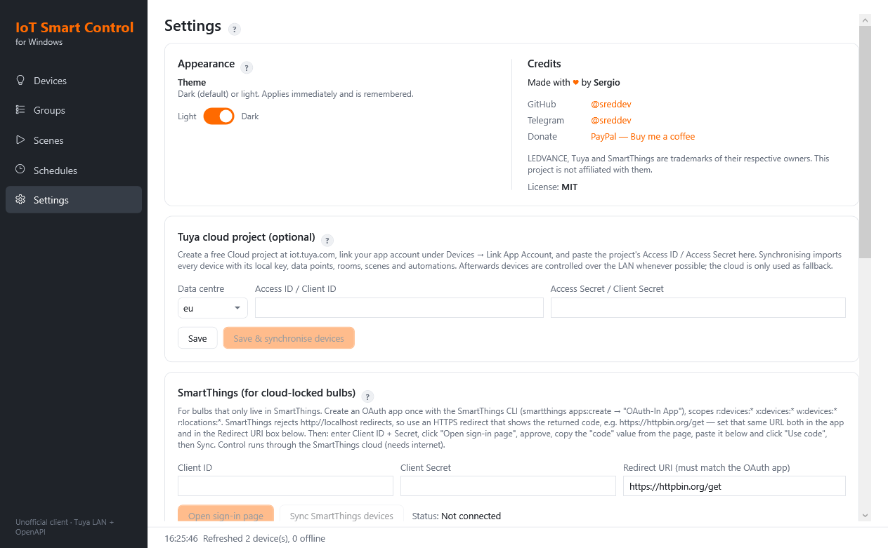
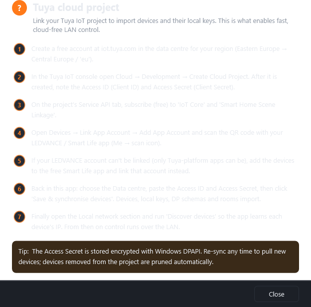

<p align="center">
  
</p>

<h1 align="center">IoT Smart Control for Windows</h1>

<p align="center">
  An unofficial Windows desktop app (C# / .NET 10 / WPF) for LEDVANCE SMART+ WiFi lights and plugs —
  controlled locally over your Wi-Fi, through the Tuya cloud, or through Samsung SmartThings.
</p>

It brings the day-to-day features of the **LEDVANCE SMART+ WiFi Android app** (v1.3.2) to Windows as a native,
local-control-first client, with Dark/Light theming and a tray-resident scheduler. The Smart+ app is a
white-label **Tuya Smart** client, so this app speaks the same protocols Tuya devices already use rather than
reusing the vendor's embedded credentials.

## Screenshots

| Light panel (Devices) | Plug energy monitor |
|---|---|
|  |  |

| Settings | Schedules |
|---|---|
|  |  |

Dark (default) and Light themes — toggle in **Settings → Appearance**:

| Devices (light) | Settings (light) |
|---|---|
|  |  |

## In-app help

Every page title and every Settings section has a **?** indicator that opens a themed, step-by-step guide —
so the connectivity and setup instructions below are also available inside the app.



## Features

### Implemented

| Smart+ Android app | This app |
|---|---|
| Device list grouped by room, on/off | **Devices** page grouped by room, quick toggles, live LAN / Cloud / SmartThings / Offline status |
| Light panel | Power, white mode (brightness, colour temperature), colour mode (hue / saturation / brightness, quick colours) and the 8 built-in Tuya light scenes (Night, Reading, …) |
| Socket / plug panel | **Energy monitor**: live power draw (W), voltage (V), current (A) and cumulative energy (kWh), read from the plug's metering DPs — plus the plug on/off switch |
| Generic device panels | Every data point (DP) rendered from the device schema: switches, sliders, drop-downs, text; read-only values (power, voltage, …) shown too |
| Groups | **Groups**: user-defined groups controlled together (power, brightness, colour, scenes) |
| Scenes / tap-to-run | **Scenes**: local scenes captured from current device states, plus cloud scenes (run) and cloud automations (enable/disable) |
| Timers / schedules | **Schedules**: daily / weekday timers for a device, group or scene, optional brightness; the app stays in the tray while schedules are enabled |
| Account / home | **Settings**: appearance, Tuya cloud sync, SmartThings connect/sync, LAN discovery, tinytuya import, manual devices, per-device connection details |

### Not implemented

These need Tuya's private app credentials or hardware Windows doesn't have, so pair/manage them with the phone
app once — this app then controls the devices:

- **Pairing brand-new devices** to Wi-Fi (EZ/AP/BLE onboarding)
- **BLE mesh**, **cameras**, **firmware (OTA) updates**
- **Device sharing** between accounts
- **Alexa / Google Home linking**
- Live power **measurement for bulbs** — smart bulbs have no power-meter chip, so they report no
  voltage/current/power. (A *rated-wattage × brightness* estimate is feasible and may be added later.)

## How it connects

The app reaches your devices by three routes and prefers the local one automatically:

1. **Tuya LAN protocol** (3.1 / 3.3 / 3.4 / 3.5) — direct, cloud-free control over your Wi-Fi. Needs each
   device's **local key** (from the Tuya cloud sync or a tinytuya import) and its IP.
2. **Tuya IoT Platform OpenAPI** — device lists, local keys, DP schemas, rooms, cloud scenes and automations;
   also the fallback channel when a device isn't reachable on the LAN.
3. **Samsung SmartThings** (OAuth 2.0 REST) — for bulbs **brand-locked to LEDVANCE** that can't be re-paired to
   Tuya/Smart Life but are visible in SmartThings. On/off, brightness, colour and colour-temperature.

> **Brand-locking.** LEDVANCE bulbs ship locked to the LEDVANCE app and won't pair to generic Tuya/Smart Life
> (pairing fails at cloud registration), and Tuya→SmartThings linking is one-way. If your bulbs are in this
> state, use the **SmartThings** route below.

## Connectivity guide

You only need **one** route per device. Use **Tuya** if your account links to the Tuya IoT platform (gives you
true local control); use **SmartThings** if your bulbs are brand-locked.

### A) Tuya cloud + local control — step by step

1. Go to <https://iot.tuya.com> and create a free account in the data centre that matches your region
   (Eastern Europe → **Central Europe / `eu`**).
2. **Cloud → Development → Create Cloud Project.** Pick your data centre. After creation, note the
   **Access ID / Client ID** and **Access Secret / Client Secret**.
3. On the project's **Service API** tab, subscribe (free) to **IoT Core** and **Smart Home Scene Linkage**.
4. Open the **Devices** tab → **Link App Account** → **Add App Account**, and scan the QR code with your
   LEDVANCE/Smart Life app ("Me → ⊙ scan"). Your devices now appear under the project.
   *If your LEDVANCE account can't be linked (only Tuya-platform apps can), add the bulbs to the free
   **Smart Life** app and link that account instead.*
5. In this app: **Settings → Tuya cloud project**, choose the data centre, paste **Access ID** and
   **Access Secret**, and press **Save & synchronise devices**. Devices, local keys, DP schemas and rooms import.
6. **Settings → Local network → Discover devices (10 s)** so the app learns each device's IP and protocol
   version. Allow it through the Windows firewall when prompted. From then on control runs over the LAN, with
   the cloud as fallback.

### B) SmartThings — step by step (for brand-locked bulbs)

1. Make sure the bulbs already work in the **SmartThings** app on your phone.
2. Install the SmartThings CLI and create an **OAuth-In** app:
   ```
   smartthings apps:create
   ```
   Choose **OAuth-In App**; set scopes `r:devices:* x:devices:* w:devices:* r:locations:*`.
   For the redirect URI, SmartThings rejects `http://localhost`, so use an HTTPS page that just echoes the
   returned code — e.g. `https://httpbin.org/get`. Note the generated **Client ID** and **Client Secret**.
3. In this app: **Settings → SmartThings**, enter the **Client ID**, **Client Secret** and the same
   **Redirect URI** you registered.
4. Click **Open sign-in page**, approve access in the browser, and copy the **`code`** value from the resulting
   URL/page.
5. Paste it into the app and click **Use code**, then **Sync SmartThings devices**. Status shows **Connected**
   and control runs through the SmartThings cloud (needs internet).

### C) Already have tinytuya?

If you ran `python -m tinytuya wizard` before and have a `devices.json`, skip the cloud setup:
**Settings → Local network → Import tinytuya devices.json…**, then **Discover devices**.

## Settings reference

Every section on the **Settings** page (Appearance and Credits aside):

- **Tuya cloud project** — connect to your Tuya IoT project: pick the data centre, enter Access ID / Secret, and
  **Save & synchronise devices** to import devices, local keys, DP schemas, rooms, cloud scenes and automations.
  Optional; needed only for the Tuya route.
- **SmartThings** — connect a SmartThings OAuth app (Client ID, Secret, Redirect URI). **Open sign-in page** →
  approve → paste the **code** → **Use code**, then **Sync SmartThings devices**. The connection status is shown
  here. Use this for bulbs that only live in SmartThings.
- **Local network** — **Discover devices (10 s)** listens to the UDP broadcasts devices send (ports
  6666/6667/7000) and fills in IP addresses and protocol versions of known devices; allow the app through the
  Windows firewall when asked. **Import tinytuya devices.json…** loads devices from a tinytuya export. Results
  appear in a table (device id, IP, version, product key).
- **Devices** — edit names, rooms and connection details for every known device: IP address, protocol version,
  local key, and **LAN first** (use the local network when an IP and key are known). **Cloud** shows whether the
  device came from a cloud sync. **Apply changes** saves; **Remove selected** deletes a device.
- **Add a device manually** — add a device by hand when you already know its **id**, **local key** (16 chars),
  **IP**, protocol **version** and **type** (`dj` = light, `cz` = plug, `kg` = switch). Useful for devices not
  discovered automatically.

## Build & run

```
dotnet build LedvanceControl.slnx -c Release
dotnet run --project src/LedvanceControl.App
```

Run `dotnet test` for the protocol tests (a simulated 3.3/3.4/3.5 device lives in
`tests/LedvanceControl.Tests/FakeTuyaDevice.cs`).

Configuration is stored in `%APPDATA%\IoTSmartControl\config.json` (a config from an earlier build under
`%APPDATA%\LedvanceControl` is migrated automatically on first run). The Tuya cloud secret, SmartThings client
secret and refresh token, and device local keys are encrypted with Windows DPAPI for the current user.
Set `LEDVANCE_CONFIG` to use a different file.

## Project layout

```
src/LedvanceControl.Core     protocol + logic (no UI)
  Local/   TuyaCodec (framing, crypto), TuyaLocalClient (TCP session), TuyaDiscovery (UDP)
  Cloud/   TuyaCloudClient (OpenAPI signing), SmartThingsClient (OAuth + REST), SmartThingsMapping (capability↔DP)
  Lights/  HsvColor (Tuya colour encodings), LightProfile (DP mapping, scenes)
  Model/   config, DPAPI store, default DP schemas, tinytuya importer
  Services/DeviceManager, DeviceRuntime (LAN → Cloud → SmartThings routing), Scheduler
src/LedvanceControl.App      WPF UI (MVVM), Dark/Light themes, energy monitor, tray scheduler
tests/LedvanceControl.Tests  xUnit tests incl. a fake Tuya device
```

## Credits

Made with ♥ by Sergio — GitHub [@sreddev](https://github.com/sreddev) · Telegram [@sreddev](https://t.me/sreddev).

LEDVANCE, Tuya and SmartThings are trademarks of their respective owners. This project is not affiliated with them.

## License

MIT.
