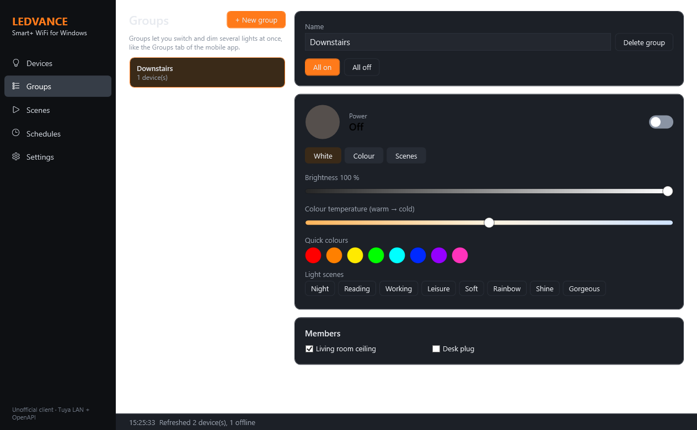
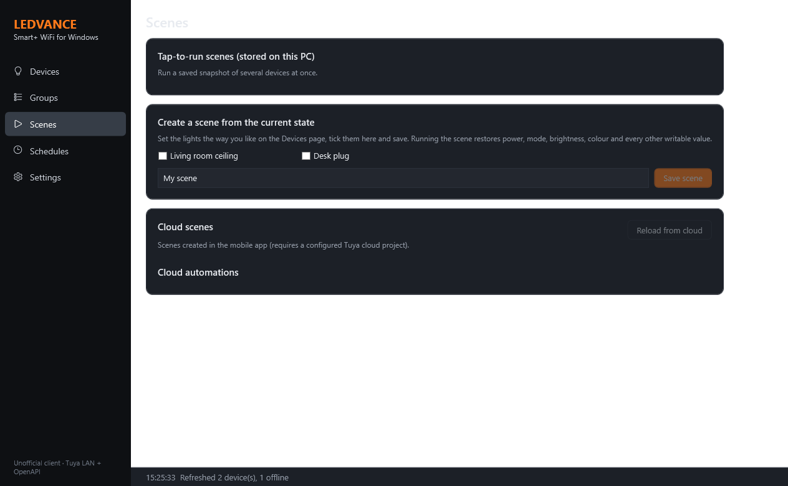

<p align="center">
  
</p>

<h1 align="center">IoT Smart Control for Windows</h1>

<p align="center">
  An unofficial Windows desktop app (C# / .NET 10 / WPF) for LEDVANCE SMART+ WiFi lights and plugs —
  controlled locally over your Wi-Fi, through the Tuya cloud, or through Samsung SmartThings.
</p>

It reimplements the features of the Android app *LEDVANCE SMART+ WiFi 1.3.2* as a native,
local-control-first Windows client with Dark/Light theming and a tray-resident scheduler.

## Screenshots

| Devices | Settings |
|---|---|
|  |  |

| Groups | Scenes | Schedules |
|---|---|---|
|  |  |  |

The app ships Dark (default) and Light themes; the toggle lives in **Settings → Appearance**:

| Devices (light) | Settings (light) |
|---|---|
|  |  |

## What the APK turned out to be

`LEDVANCE+SMART++WiFi_1.3.2_APKPure.apk` (package `com.ldvsmartwifi.smart`) is a white-label
**Tuya Smart** app (Tuya "OEM App" SDK, Flutter shell plus native Tuya modules):

| Area | Findings in the APK |
|---|---|
| Cloud | Tuya mobile API (`a1.tuyaeu.com`, `a1.tuyaus.com`, …), `tuya.m.device.*` actions, signed with an app key/secret that is obfuscated in the APK (`t_s.bmp`, native libs) |
| Tabs | `ty_device`, `ty_group`, `ty_scene`, `mall`, `ty_personal` (`assets/tab_config.json`) |
| Device panels | downloaded at runtime (React Native/Web panels) and driven by each device's DP (data point) schema |
| Modules | pairing (EZ/AP/BLE), groups, scenes and automations, timers, sharing, OTA, Alexa/Google, cameras, BLE mesh, geofencing, push notifications |
| Local control | Tuya LAN protocol (TCP 6668, UDP broadcasts 6666/6667/7000) |

This app doesn't reuse the vendor's embedded credentials. It uses supported routes into the devices instead.

## Control routes

1. **Tuya LAN protocol** (3.1, 3.3, 3.4 and 3.5): direct, cloud-free control over your Wi-Fi.
   It covers AES-ECB/CRC32 framing, 3.4 session-key negotiation with HMAC-SHA256, 3.5 AES-GCM framing and UDP discovery.
   Needs each device's **local key**, which comes from the Tuya cloud sync below or a tinytuya import.
2. **Official Tuya IoT Platform OpenAPI**: gets device lists, local keys, DP schemas, rooms, cloud scenes and
   automations, and is the fallback channel when a device isn't reachable on the LAN.
3. **Samsung SmartThings** (OAuth 2.0 REST): for bulbs that are **brand-locked to LEDVANCE** and so can't be
   re-paired to Tuya/Smart Life, but *are* visible in SmartThings. The app connects via a SmartThings OAuth app,
   reads device status and sends on/off, brightness, colour (hue/saturation) and colour-temperature commands,
   and runs diagnostics. This is the viable path when neither LAN nor Tuya OpenAPI can reach a locked bulb.

> **Note on brand-locking.** LEDVANCE bulbs ship locked to the LEDVANCE app and will not pair to generic Tuya/Smart
> Life (pairing fails at cloud registration), and Tuya→SmartThings linking is one-way. If your bulbs are in this
> state, use the **SmartThings** route in Settings.

## Features

| Android app | This app |
|---|---|
| Device list grouped by room, on/off | **Devices** page, grouped by room, quick toggles, LAN / Cloud / SmartThings / Offline status |
| Light panel | Power, white mode (brightness, colour temperature), colour mode (hue/saturation/brightness, quick colours), the 8 built-in Tuya scenes (Night, Reading, …) |
| Generic device panels (plugs, switches, …) | Every DP rendered from the device schema: switches, sliders, drop-downs, text. Read-only values (power, voltage, …) are shown too |
| Groups tab | **Groups**: user-defined groups controlled together (power, brightness, colour, scenes) |
| Scenes tab | **Scenes**: local tap-to-run scenes captured from current device states, plus cloud scenes (run) and cloud automations (enable/disable) |
| Timers / schedules | **Schedules**: daily/weekday timers for a device, group or scene, with optional brightness. Closing the window keeps the app in the tray while schedules are enabled |
| Account / home | **Settings**: appearance (Dark/Light), Tuya cloud project + sync, SmartThings connect/sync, LAN discovery, tinytuya `devices.json` import, manual devices, per-device IP/key/version/LAN-first |

Not implemented, because they need Tuya's private app credentials or hardware Windows doesn't have:
Wi-Fi pairing of *new* devices, BLE mesh, cameras, OTA, device sharing, Alexa/Google linking.
Pair new devices with the phone app once; this app then controls them.

## Getting started

1. Build and run:
   ```
   dotnet build LedvanceControl.slnx -c Release
   dotnet run --project src/LedvanceControl.App
   ```
   Or run `dotnet test` for the protocol tests. A simulated 3.3/3.4/3.5 device is in `tests/LedvanceControl.Tests/FakeTuyaDevice.cs`.
2. Connect your devices using **one** of the routes:
   - **Tuya cloud sync (recommended for Tuya-reachable devices):** create a free *Cloud Development* project at
     <https://iot.tuya.com> in the data centre matching your account (Europe = `eu`). Enable the *IoT Core* and
     *Smart Home Scene Linkage* APIs. Link your app account under *Devices → Link App Account* by scanning the QR
     code with the app. Paste the Access ID and Secret into **Settings → Tuya cloud project** and press
     *Save & synchronise devices*.
   - **SmartThings (for brand-locked bulbs):** create a SmartThings OAuth app
     (`smartthings apps:create` → *OAuth-In App*, scopes `r:devices:* x:devices:* w:devices:* r:locations:*`).
     SmartThings rejects `http://localhost` redirects, so use an HTTPS redirect that echoes the code
     (e.g. `https://httpbin.org/get`). Enter Client ID + Secret in **Settings → SmartThings**, click *Open sign-in
     page*, approve, copy the `code` value, paste it back and click *Use code*, then *Sync*.
   - **tinytuya:** if you already have a `devices.json` from `python -m tinytuya wizard`, use *Import tinytuya devices.json…*.
3. For LAN control, press **Discover devices** so the app learns each device's LAN IP and protocol version.
   From then on, control goes over the LAN whenever possible, with the cloud as fallback.

Configuration is stored in `%APPDATA%\LedvanceControl\config.json`. The Tuya cloud secret, SmartThings client
secret and refresh token, and device local keys are encrypted with Windows DPAPI.
Set `LEDVANCE_CONFIG` to use a different file.

## Project layout

```
src/LedvanceControl.Core     protocol + logic (no UI)
  Local/   TuyaCodec (framing, crypto), TuyaLocalClient (TCP session), TuyaDiscovery (UDP)
  Cloud/   TuyaCloudClient (OpenAPI signing), SmartThingsClient (OAuth + REST), SmartThingsMapping (capability↔DP)
  Lights/  HsvColor (Tuya colour encodings), LightProfile (DP mapping, scenes)
  Model/   config, DPAPI store, default DP schemas, tinytuya importer
  Services/DeviceManager, DeviceRuntime (LAN → Cloud → SmartThings routing), Scheduler
src/LedvanceControl.App      WPF UI (MVVM), Dark/Light themes, tray scheduler
tests/LedvanceControl.Tests  xUnit tests incl. a fake Tuya device
```

## Credits

Made with ♥ by Sergio — GitHub [@sreddev](https://github.com/sreddev) · Telegram [@sreddev](https://t.me/sreddev).

LEDVANCE, Tuya and SmartThings are trademarks of their respective owners. This project is not affiliated with them.

## License

MIT.
