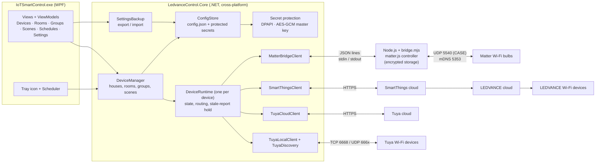
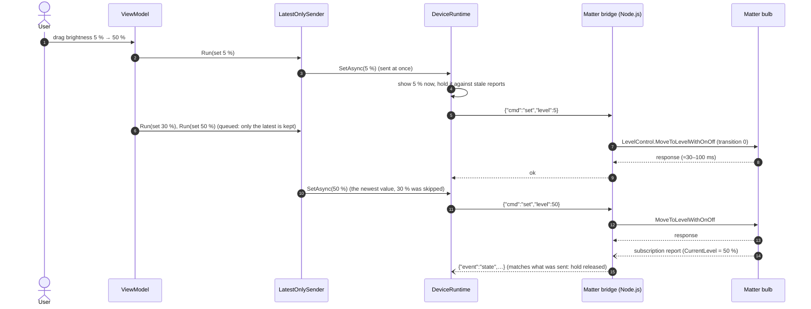
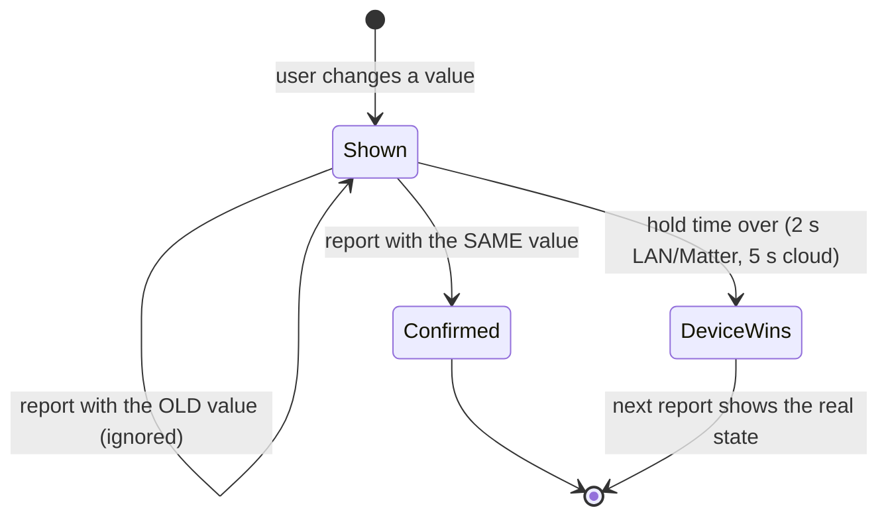
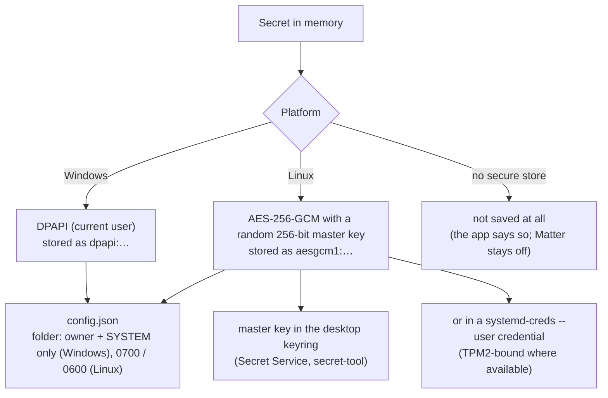
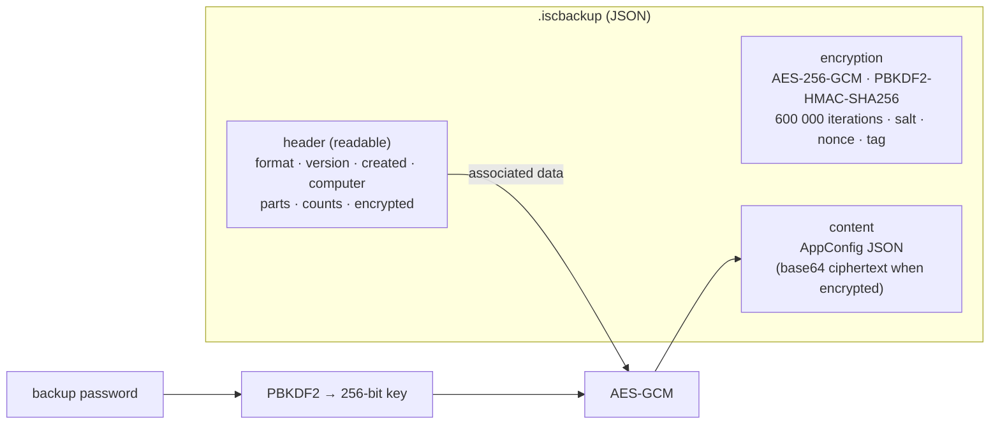
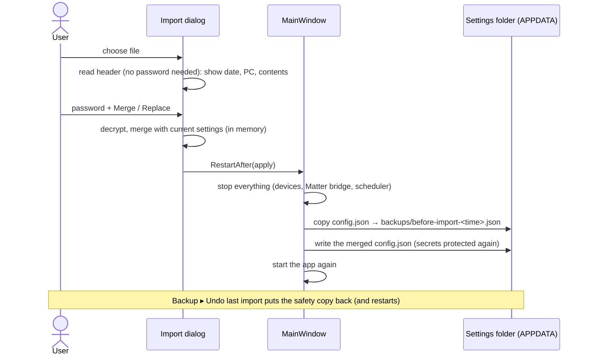
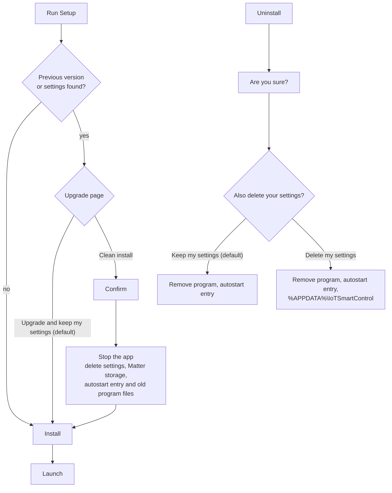

# Architecture

How IoT Smart Control is built: the technology it uses, how the parts talk to each other, how a click becomes
light, how secrets are protected, and how backups and the installer work. For what was learned about the
LEDVANCE, Matter, SmartThings and Tuya ecosystems themselves, see
[INTEGRATION-NOTES.md](INTEGRATION-NOTES.md).

- [1. Technology](#1-technology)
- [2. Components](#2-components)
- [3. From a click to the device](#3-from-a-click-to-the-device)
- [4. Keeping the UI honest (latency and stale state)](#4-keeping-the-ui-honest-latency-and-stale-state)
- [5. Protecting secrets](#5-protecting-secrets)
- [6. Backup & restore](#6-backup--restore)
- [7. Installation, upgrade and removal](#7-installation-upgrade-and-removal)
- [8. Testing](#8-testing)

---

## 1. Technology

| Area | Technology | Why |
|---|---|---|
| Language / runtime | **C# 13, .NET 10** | One codebase for logic and UI; the core library is cross-platform (tested on Windows and Fedora). |
| Desktop UI | **WPF**, MVVM (own minimal `ObservableObject` / `RelayCommand`), Dark & Light resource dictionaries | Native Windows look, tray integration, per-monitor DPI. |
| Tuya LAN | Own implementation of the Tuya protocol **3.1 / 3.3 / 3.4 / 3.5** (TCP 6668, AES-ECB / AES-GCM, HMAC session keys), UDP discovery on 6666/6667/7000 | Cloud-free control; no third-party Tuya library. |
| Tuya cloud | Tuya IoT **OpenAPI** with HMAC-SHA256 request signing | Device list, local keys, schemas, rooms, cloud scenes. |
| SmartThings | **OAuth 2.0** + REST (`api.smartthings.com`) | For bulbs brand-locked to LEDVANCE. |
| Matter | **matter.js 0.18** controller in a **Node.js** sidecar, bundled into one file with **esbuild**; JSON lines over stdin/stdout | The only mature open-source Matter controller that runs on Windows without a hub. |
| Secret storage | **DPAPI** (Windows); **AES-256-GCM** with a master key in the **Secret Service** keyring or **systemd-creds** (Linux) | Nothing secret is ever written in plain text. |
| Backups | **AES-256-GCM** + **PBKDF2-HMAC-SHA256** (600 000 iterations), `System.Security.Cryptography` | Portable, password-protected, tamper-evident. |
| Tests | **xUnit** (95 tests), an in-process fake Tuya device, a fake SmartThings API, an off-screen WPF render harness and UI Automation end-to-end runs | |
| Packaging | **Inno Setup 6** (`.exe` installer) and **MSIX** (Desktop Bridge), both self-contained with Node.js bundled | No .NET or Node.js install needed on the target PC. |

## 2. Components

- **`LedvanceControl.Core`** holds all logic and protocols and has no UI dependency, so it can back a future
  Linux UI (Avalonia) unchanged.
- **`DeviceRuntime`** decides per command which route to use: Matter for paired Matter bulbs, SmartThings for
  SmartThings devices, otherwise **LAN first** (when an IP and local key are known) with the Tuya cloud as
  fallback.
- **The Matter bridge** is a separate process so the Node.js ecosystem (matter.js) can be used from .NET. It
  starts on first use, keeps CASE sessions and subscriptions open, and pushes state changes back as events.

## 3. From a click to the device

Measured round trips with an open session: **Matter 30–200 ms**, **Tuya LAN ~50–150 ms**, **SmartThings
350–950 ms** to the API, plus the cloud-to-cloud hop to the device.

## 4. Keeping the UI honest (latency and stale state)

Three mechanisms, each added after measuring real devices:

| Mechanism | Where | Problem it solves |
|---|---|---|
| **Latest-only sending** | `Core/Services/LatestOnlySender.cs` | A debounce timer delayed every change by 250–300 ms. Now the first change goes out immediately; while one command is in flight, newer values replace each other and only the newest is sent next. The final slider position always arrives. |
| **Zero transition time for Matter** | `MatterBridge/bridge.mjs` | LEDVANCE SMART MAT bulbs (fw 1.1.0) turn **any** non-zero `transitionTime` (even 0.1 s) into a ~4.5–5 s ramp. With `transitionTime = 0` they reach the new level in ~0.2–0.35 s. Off uses `OffWithEffect` (no fade); On switches straight to the current level. |
| **Stale-report hold + verification** | `Core/Services/DeviceRuntime.cs` | Cloud status lags 0.5–3 s behind a command, so a refresh could flip a switch or slider back ("I had to click twice"). A value just sent wins over older reports for 2 s (LAN/Matter) or 5 s (cloud), then the device's value wins again. For SmartThings, 4 s after the last change the app reads the status and resends power / brightness once if they didn't take. |

## 5. Protecting secrets

Secrets are the Tuya client secret, the SmartThings client secret and refresh token, each device's Tuya local
key, and the key that encrypts the Matter controller storage.

- **Matter storage.** The bridge receives its storage key over stdin (never on the command line, where other
  processes could read it) and encrypts every stored value — fabric root key, operational key, certificates —
  with AES-256-GCM, binding each value to its storage path.
- **In the UI.** Local keys are masked (`••••`); clicking a cell reveals that one key. Sorting the column sorts
  by *has a key*, never by the key itself. Password boxes never expose their value to UI Automation.
- **Legacy files.** A config written by an older version in plain text is re-encrypted the first time it is
  loaded.

## 6. Backup & restore

**Settings → App settings → Backup** exports everything to one `.iscbackup` file and imports it on this or
another PC. Implementation: `Core/Backup/SettingsBackup.cs` (format, crypto, merge rules, safety copies),
`App/Views/ExportBackupWindow` and `ImportBackupWindow` (dialogs).

### File format

- **Parts** you can choose: houses, rooms & devices · groups, scenes & schedules · app preferences & cloud
  accounts · keys & credentials.
- **Keys are only exported with a password.** Without a password every secret is removed before writing, and
  the content is plain JSON.
- **Tamper-evident.** The header is authenticated together with the content, so changing either (even only
  the device count shown in the preview) makes decryption fail with *"Wrong password, or the file was changed
  after it was exported."*
- **Never exported:** the Matter storage key. Matter pairings belong to this PC; on another PC the bulbs are
  paired again.

### Import

| | **Merge** | **Replace** |
|---|---|---|
| Items in the file | added, or replace the ones with the same id | used as they are |
| Items only on this PC | kept | removed (only for the parts the file carries) |
| Rooms of a house in both | combined | the file's |
| Keys the file doesn't carry | kept from this PC | kept from this PC |
| Matter storage key | always this PC's | always this PC's |

## 7. Installation, upgrade and removal

The release ships two Windows packages, both self-contained (.NET runtime and Node.js included):

| | `IoTSmartControl-<ver>-Setup-x64.exe` (recommended) | `IoTSmartControl_<ver>.0_x64.msix` |
|---|---|---|
| Built with | Inno Setup 6 (`packaging/installer/IoTSmartControl.iss`) | `makeappx` + `signtool` (`packaging/build-msix.ps1`) |
| Installs for | the current user (no admin), or all users | the current user |
| Settings | `%APPDATA%\IoTSmartControl` | the package's private `%APPDATA%` |
| Start with Windows | supported | not used under MSIX |
| Clean install / delete settings | built in (below) | Windows removes package data on uninstall |

Unattended use: `Setup.exe /VERYSILENT /CLEANINSTALL` and `unins000.exe /VERYSILENT /DELETEDATA`.

## 8. Testing

| Layer | How |
|---|---|
| Protocols | A fake Tuya device speaking 3.3 / 3.4 / 3.5 over real sockets; codec vectors; SmartThings and Matter mappings |
| Secrets | DPAPI and AES-GCM protectors, fake keyring tools; real Secret Service / systemd-creds runs on Fedora (opt-in) |
| Device state | A fake SmartThings API that confirms late or drops commands: stale reports must not flip values back; lost changes are resent |
| Backup | Round trips with and without password, wrong password, changed content, changed header, foreign and newer files, merge and replace rules, safety copies |
| UI | Off-screen render harness (binding errors, layouts, screenshots); UI Automation end-to-end runs on the real exe (export → import → restart → undo) |
| Installer | Fresh install, upgrade keeping settings, clean install, uninstall keeping and deleting settings, with the user's real data moved aside during the run |
| Real devices | Latency probes against the paired Matter bulbs and SmartThings devices, with every change read back from the device |
